# Console RPG

A multiplayer roguelike for the terminal, written in C# on .NET 9. One process runs an
authoritative game server; up to nine clients connect over TCP, send keystrokes as JSON, and
render the world state the server broadcasts back. The game model (procedural dungeons,
enemies with sound- and sight-driven behaviour, slotted and decorated weapons, three attack
styles) is written against classic GoF patterns and is fully decoupled from both the console
and the network.

The project was built in seven stages for the Object-Oriented Programming course at Warsaw
University of Technology. It started as a single-process console game and was refactored into
the client–server, MVC-structured system described here.

## Preview

All images below are captures of the real application running on macOS with the default
`Vault` theme. The recording is about 30 seconds of a scripted client session (walls are `█`, items are single glyphs, enemies are lowercase letters, players
are digits).

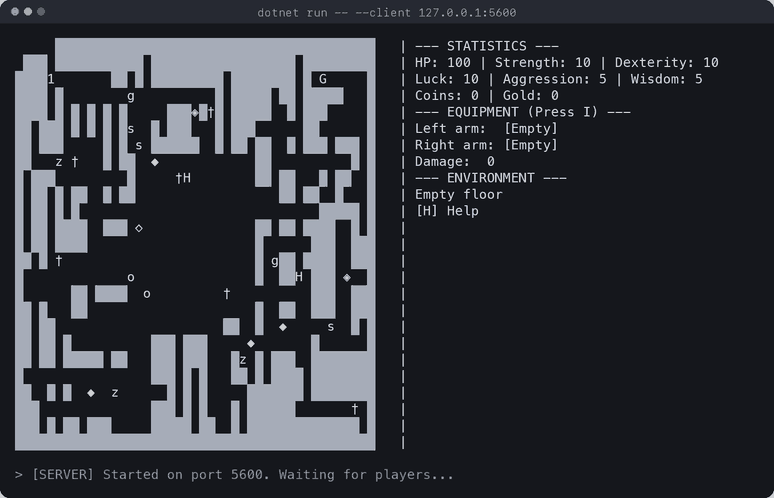

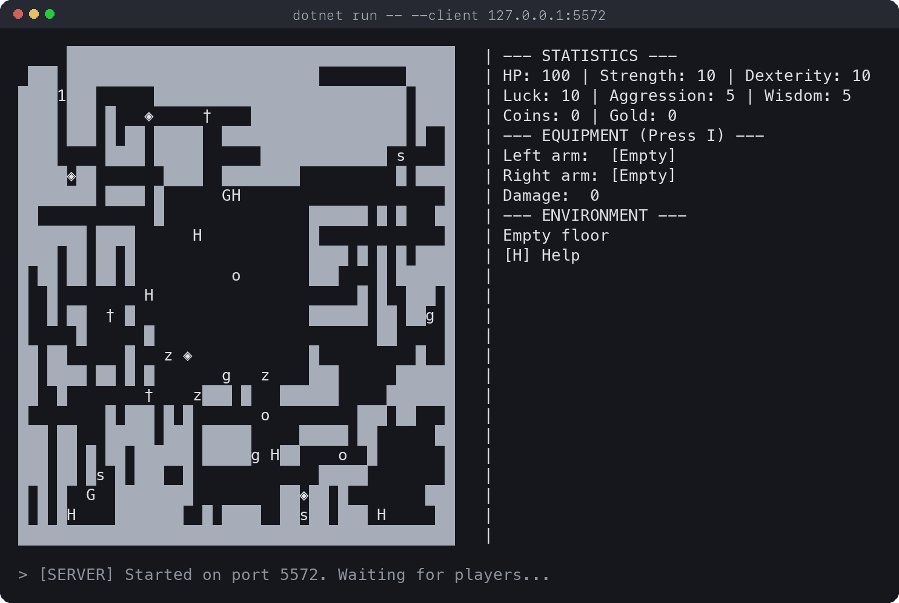

| Inventory mode after equipping the nested slotted sword | Normal attack on an adjacent zombie |
| :--: | :--: |
| 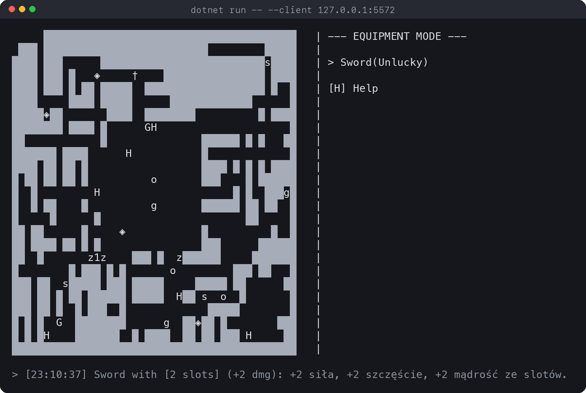 | 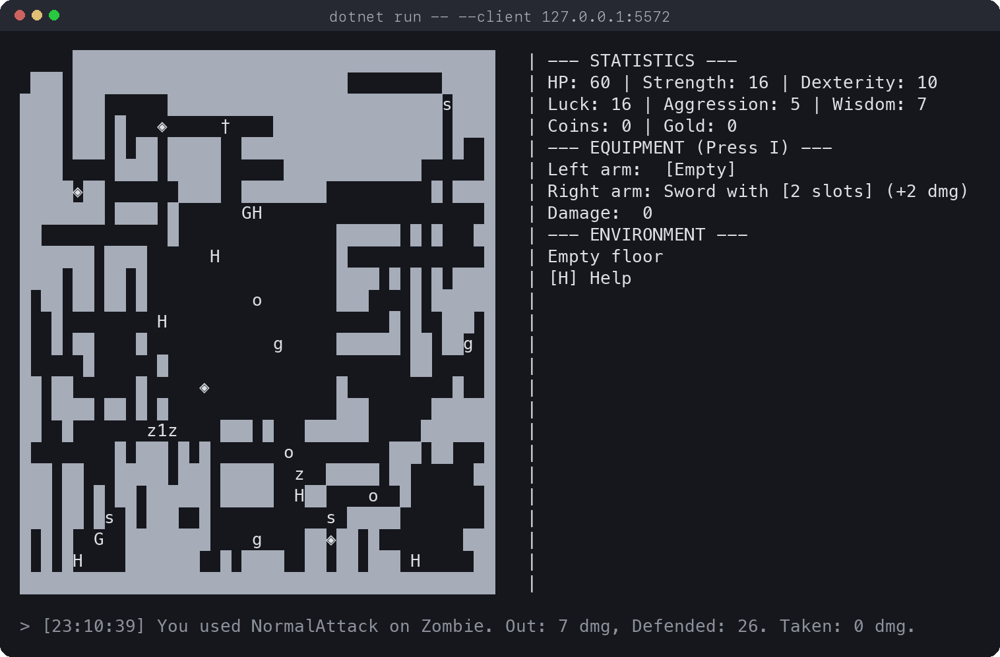 |

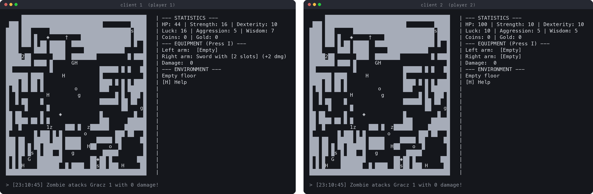

| Event log history (`J`), including the species-death reaction of the surviving zombies | Context-sensitive help (`H`) lists only the actions that are currently executable |
| :--: | :--: |
| 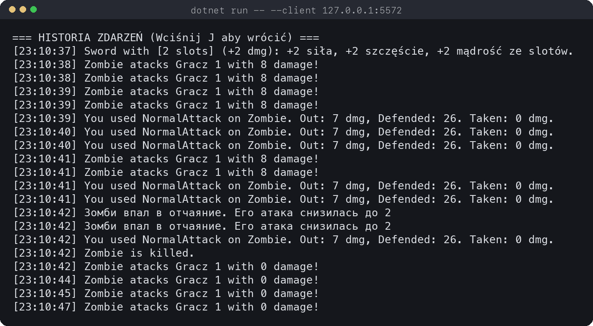 | 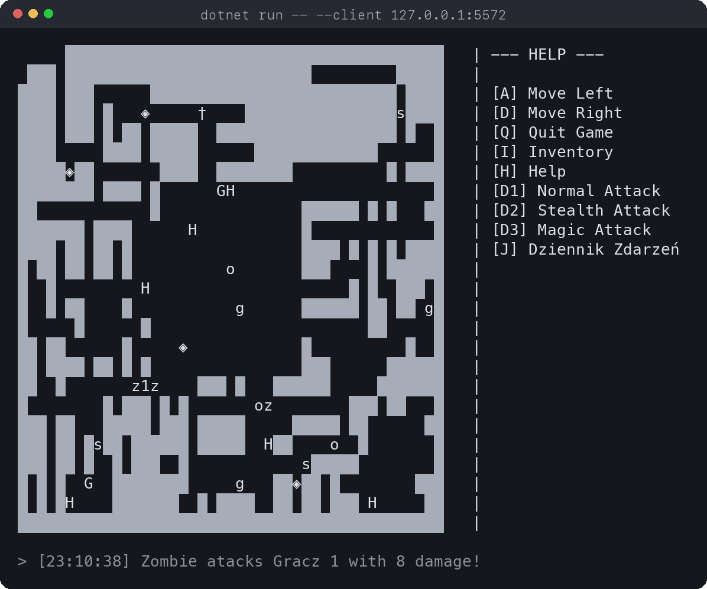 |

## Gameplay

- Explore a procedurally generated dungeon whose size, layout steps, item pool, artifact and
  enemy roster come from one of three themes (`Vault`, `Library`, `SciFi`).
- Pick up coins and gold (applied to the wallet), weapons, stones and handles. Picking up a
  weapon makes noise that propagates through corridors and alerts nearby enemies.
- Equip items into the left or right hand. Two-handed weapons occupy both hands; every
  generated weapon is wrapped in a random `(Strong)` or `(Unlucky)` modifier.
- Insert stones and handles into the slots of a slotted sword. Handles have slots of their own,
  so bonuses are summed recursively.
- Fight with three attack styles (normal, stealth, magic) whose damage and defence depend on
  the weapon class in each hand and on the player's statistics.
- Enemies react to what they see and hear: zombies chase, goblins flee, skeletons ignore you
  until hit and then either chase or flee depending on their remaining health. When a member of
  a species dies, its kin are notified and adjust their stats.

### Controls

| Key | Map mode | Inventory mode |
| --- | --- | --- |
| `W` `A` `S` `D` | Move (moving into an enemy performs a normal attack) | Move cursor up / down |
| `E` | Pick up the top item on the current cell | |
| `1` `2` `3` | Normal / stealth / magic attack on an adjacent enemy | Unequip left / right hand |
| `I` | Open inventory | Back to map |
| `L` `R` | | Equip selected item in the left / right hand |
| `F` | | Insert selected stone or handle into a free slot of the wielded item |
| `Q` | Quit | Drop selected item |
| `H` | Help (lists only the currently executable actions) | Help |
| `J` | Event log history (last 20 entries) | |

## Architecture

The solution is a single executable that runs either as the server or as a client, selected by
command-line flag or by an interactive prompt.

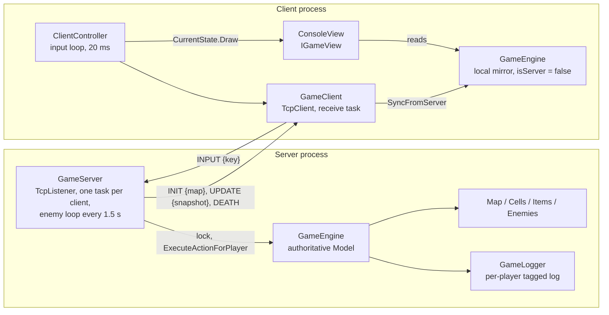

**Model** (`MVC/Model`) owns all game rules: the map grid, entities, items, combat, dungeon
generation, logging and the UI state machine. It has no reference to `System.Console` or to
sockets.

**View** (`MVC/View`) is `ConsoleView`, the only class that writes to the terminal. It draws
the map, the side panel for the current UI state, the last log line, and the log history.

**Controller** (`MVC/Controller`) contains the network layer and the input loop. `GameServer`
hosts the authoritative engine, `GameClient` keeps a local mirror of the state, and
`ClientController` reads keys, forwards them to the server and redraws the view.

### Network protocol

Messages are newline-delimited JSON. Every line is a `NetworkMessage { Type, Payload }` where
`Payload` is itself a serialized DTO.

| Type | Direction | Payload |
| --- | --- | --- |
| `INIT` | server → client | Map dimensions and one string per row (`#` wall, `.` floor). Sent once on connect. |
| `UPDATE` | server → client | Full snapshot: every player (position, stats, hand and inventory item names), every enemy and item on the map, and the last 20 log lines visible to that player. |
| `INPUT` | client → server | The pressed `ConsoleKey` as a string. |
| `DEATH` | server → client | Final message when the player's health reaches zero. |

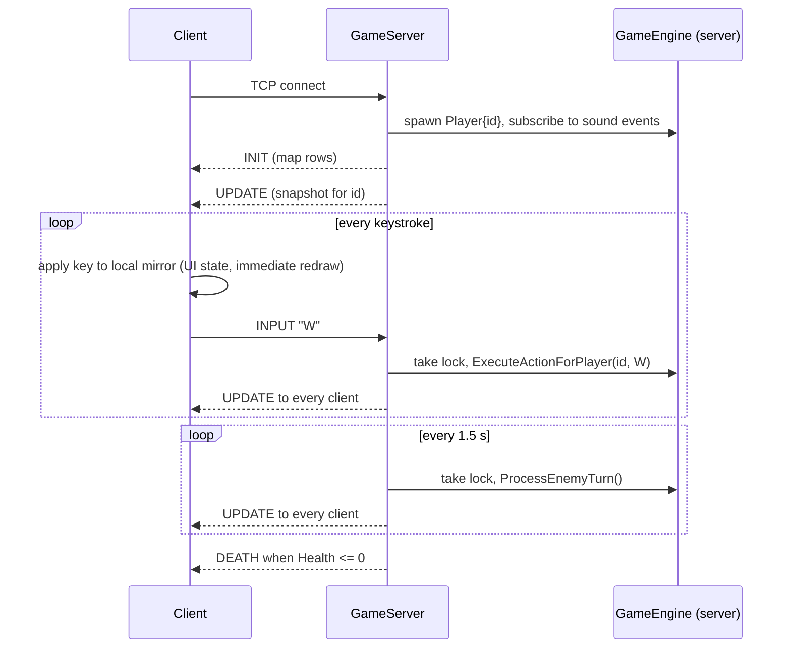

Design choices worth knowing:

- **The server is authoritative.** Clients never mutate world state from their own input; they
  apply the key to a local engine only so the UI mode (map / inventory / help) changes
  instantly, then overwrite everything with the next `UPDATE`.
- **UI mode is tracked on both ends.** The server keeps an `IGameState` per player so the same
  key (`W`, `S`, `1`, `2`) is interpreted as movement, cursor movement or unequip depending
  on the mode that player is in.
- **One lock, one engine.** Each client has its own receive task, and the enemy loop runs on
  another; all of them serialize access to the engine through a single `lock` in
  `GameServer`. State is broadcast after every processed input and after every enemy turn.
- **Snapshots, not deltas.** Each `UPDATE` carries the full state. For a 45×25 map and nine
  players this is small enough that simplicity won over bandwidth.
- **Per-player log filtering.** `GameLogger` tags each entry with the player id that caused it
  (or `0` for global events). A client receives global entries plus its own, so the "you hear a
  noise" message only reaches the player who heard it.
- **Player cap of nine.** The map renders a player as its id digit, so ids are limited to 1–9.

### Core engine: states, commands and views

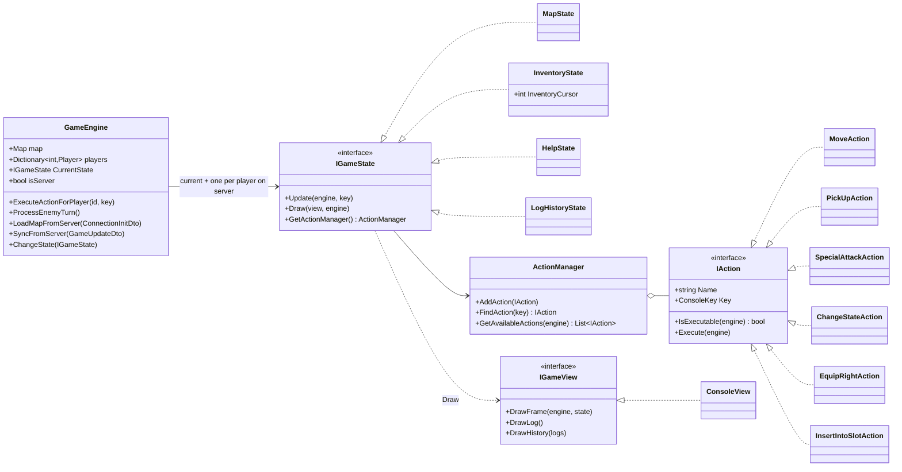

Each UI mode is a **State** that owns its own set of **Command** objects. `HelpState` is built
from the previous state's `ActionManager` and lists only the actions whose `IsExecutable`
returns true right now, which is why the help panel changes as you move next to a wall or an
enemy.

## Design patterns

| Pattern | Where | What it buys |
| --- | --- | --- |
| Command | `IAction`, `ActionManager` | Every key binding is an object with a name, a key and an executability check. Help and input dispatch are derived from the same list. |
| State | `IGameState` and its four implementations | Map, inventory, help and log-history modes reinterpret the same keys without `if (mode == ...)` chains. |
| Abstract Factory | `IDungeonThemeFactory` → `VaultThemeFactory`, `LibraryThemeFactory`, `SciFiThemeFactory` | A theme supplies the map size, the generation step list, the item pool, the artifact and the enemy roster as one coherent family. |
| Builder + Director | `IDungeonBuilder`, `LoggingDungeonBuilder`, `DungeonDirector`, `IDungeonStep` | A dungeon is produced by applying an ordered list of steps (fill, carve exit, central room, random corridors, items, artifact, enemies) to an empty map. The logging builder records each step in the event log. |
| Strategy | `ISoundBehaviour`, `IVisionBehaviour` | Chase / flee / ignore reactions are swappable objects; a skeleton changes both strategies at runtime after it is first hit. |
| Observer | `EventManagerSound`, `EventManagerDeath` (hand-rolled, no C# `event`) | Weapons notify listeners in hearing range; a dying enemy notifies the rest of its species before unsubscribing. |
| Decorator | `ItemDecorator` → `StrongModifier`, `UnluckyModifier` | Modifiers wrap any item, extend its name and damage, and can be stacked. |
| Composite (slots) | `IHasSlots`, `ISlottable`, `SlottedSword`, `Handle`, `PassiveStone` | A handle is both a slot container and slottable, so bonuses are summed through arbitrarily nested handles. |
| Visitor (double dispatch) | `IAttackVisitor` → `NormalAttack`, `StealthAttack`, `MagicAttack` | Combat formulas depend on both the attack style and the weapon class; weapons accept the visitor and the overload for their class is chosen statically. |
| Singleton | `GameLogger` | One process-wide, player-tagged event log shared by the model, server and client. |

## Implementation details

### Items, modifiers, slots and combat

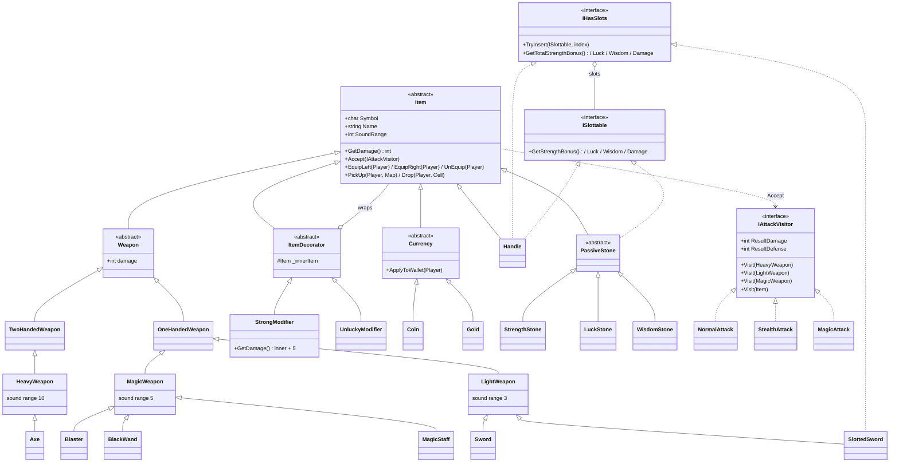

`Player.AttackEnemy` creates one visitor for the chosen style, passes it to the item in each
hand, and sums the resulting damage and defence. The enemy loses `max(0, damage − Armor)` and
hits back for `max(0, AttackValue − defence)`.

| Attack style | Heavy weapon (`Axe`) | Light weapon (`Sword`) | Magic weapon (`MagicStaff`, artifacts) |
| --- | --- | --- | --- |
| Normal (`1`, or walking into an enemy) | dmg `w + Str/2 + Aggr/2`, def `Str + Luck` | dmg `w + Dex/2`, def `Dex + Luck` | dmg `1`, def `Dex + Luck` |
| Stealth (`2`) | dmg `w/2`, def `Str` | dmg `(w + Dex + Luck) × 2`, def `Dex` | dmg `1`, def `0` |
| Magic (`3`) | dmg `1`, def `Luck` | dmg `1`, def `Luck` | dmg `w + 2·Wis`, def `2·Wis` |

`w` is the weapon's base damage; a bare hand or a non-weapon item contributes 0 damage.

The `Vault` theme's artifact shows the slot composite at full depth: a two-slot sword holding a
luck stone and a handle, where the handle holds a strength stone and another handle, which
holds a wisdom stone. Equipping it adds +2 to strength, luck and wisdom, computed recursively
through `IHasSlots.GetTotal*Bonus()`.

### Procedural dungeon generation

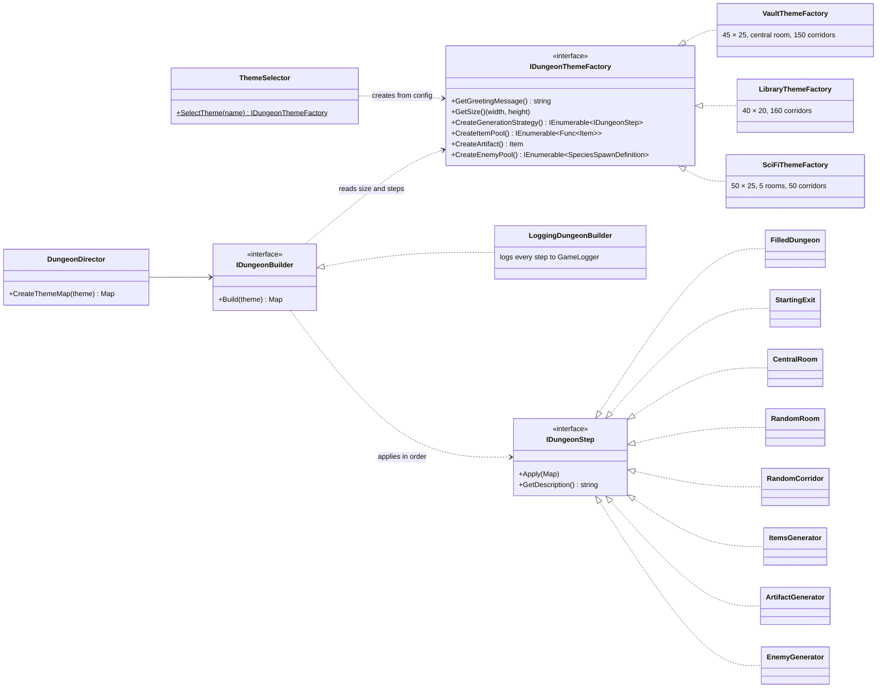

The builder validates that the first step is `EmptyDungeon` or `FilledDungeon`, then applies
the theme's steps in order. `ItemsGenerator` wraps every generated weapon in a random
decorator; `EnemyGenerator` first guarantees each species' minimum count, then fills up to the
theme's total with random species. Each species gets its own `EventManagerDeath` so death
notifications stay within the species.

### Enemy perception and behaviour

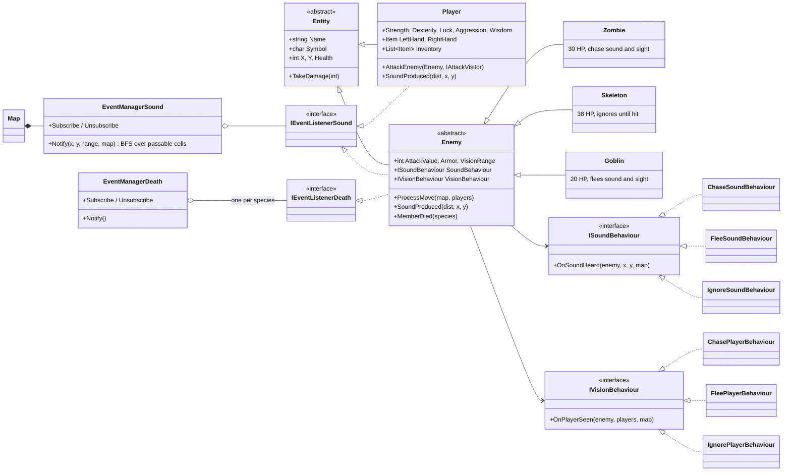

- **Sound propagation** is a breadth-first search over passable cells starting at the source,
  bounded by the item's sound range. Listeners are matched by position, so a wall between the
  player and an enemy blocks the sound even if the straight-line distance is short. Heavy
  weapons are heard 10 cells away, magic weapons 5, light weapons and handles 3, stones 2.
- **Vision** is a ray cast in the four cardinal directions up to `VisionRange` (5) that stops
  at the first wall.
- **Priority** in `Enemy.ProcessMove` is sight, then a remembered sound target, then a random
  step. Seeing a player clears the sound target.
- **Species death** uses the observer: on death an enemy unsubscribes itself from the species
  group and from the sound manager, then notifies the rest. Zombies and goblins lose attack and
  armour; skeletons gain attack.

## Technology stack

| Component | Choice | Why |
| --- | --- | --- |
| Language / runtime | C# 13, .NET 9 | Nullable reference types and implicit usings on; a single SDK-style project. |
| Networking | `System.Net.Sockets` (`TcpListener`, `TcpClient`) | Keeps the transport explicit and dependency-free; one accept loop, one task per client. |
| Serialization | `System.Text.Json` | Built-in, used for the wire format and for `config.json`. |
| Concurrency | `Task.Run`, `lock` | The engine is single-threaded by design; the lock serializes input handling and the enemy loop. |
| Terminal UI | `System.Console` | `SetCursorPosition` plus a `StringBuilder` frame avoids flicker without a TUI library. |
| Tests | xUnit 2.9, `Microsoft.NET.Test.Sdk` | Unit tests against the model with no console or network involved. |

No third-party runtime packages are used.

## Getting started

### Prerequisites

- [.NET SDK 9.0](https://dotnet.microsoft.com/download/dotnet/9.0) or newer (the project
  targets `net9.0`).
- A terminal at least 105 columns wide and 30 rows tall with a font that has `█`, `†`, `∫`,
  `◆`, `◇`, `◈` glyphs.

### Build

```bash
git clone https://github.com/anniigr/Console-RPG.git
cd Console-RPG
dotnet build ConsoleRPG_1.csproj
```

### Run

Start the server in one terminal. The port is optional and defaults to `5555`.

```bash
dotnet run --project ConsoleRPG_1.csproj -- --server 5555
```

Start one or more clients in other terminals. The address defaults to `127.0.0.1:5555`.

```bash
dotnet run --project ConsoleRPG_1.csproj -- --client 127.0.0.1:5555
```

Running without arguments opens an interactive prompt: press `S` for server or `K` for client.
Press `ESC` in the server terminal to stop it.

### Configuration

`config.json` in the working directory is read by both server and client; a default file is
written if it is missing. Only `Theme` has an effect in the current build.

```json
{
  "PlayerName": "Anna",
  "Theme": "Vault",
  "FileName": "./log"
}
```

`Theme` is one of `Vault`, `Library`, `SciFi` (case-insensitive; unknown values fall back to
`SciFi`). `PlayerName` and `FileName` are read but not used: players are named by their id and the logger is in-memory (see
limitations).

## Testing

The xUnit project lives in `tests/ConsoleRPG.Tests` and references the main project directly.
It is not part of `ConsoleRPG_1.sln`, so run it by path:

```bash
dotnet test tests/ConsoleRPG.Tests/ConsoleRPG.Tests.csproj
```

The 15 tests cover the model without touching the console or the network:

- `CombatTests`: the normal, stealth and magic visitors against light and magic weapons,
  enemy armour reduction, and damage summed from two different hands.
- `ItemAndEquipmentTests`: single and stacked decorators (`Sword(Unlucky)(Strong)`), stat
  changes on equip, swapping weapons returns the previous one to the inventory, and two-handed
  weapons occupying both hands while counting damage once.
- `WorldAndInventoryTests`: movement into floor, walls and off-map, currency pickup, and cell
  rendering priority (enemy over item over terrain).

## Project structure

```
Console-RPG/
├── Program.cs                       # argument parsing, server/client bootstrap
├── config.json                      # player name, theme, log path
├── ConsoleRPG_1.csproj / .sln
├── Config/                          # GameConfig, ConfigManager (JSON loading)
├── MVC/
│   ├── Model/
│   │   ├── Game/                    # GameEngine, IGameState + states, Actions (Command)
│   │   ├── World/                   # Map, Cell, Terrain, Generation (steps, builder, themes)
│   │   ├── Items/                   # Item hierarchy, Decorators, Slots
│   │   ├── Combat/                  # IAttackVisitor and the three attack styles
│   │   ├── Player/                  # Entity, Player, Enemy species, Behaviours, Observers
│   │   └── Logging/                 # GameLogger singleton, ILogger
│   ├── View/                        # IGameView, ConsoleView
│   └── Controller/
│       ├── Network/                 # GameServer, GameClient, ClientController, DTOs
│       └── Systems/                 # EnemySystem (runs every enemy's turn)
├── tests/ConsoleRPG.Tests/          # xUnit tests
└── docs/screenshots/                # captures used in this README
```

## Limitations and known issues

These were found while verifying the behaviour documented above and are left as-is in the
current code.

- **Connectivity is not guaranteed.** Corridors are carved at random positions, so the
  starting corridor can be disconnected from the rest of the dungeon. Restart the server to
  regenerate.
- **Empty-inventory crash.** `InventoryState.Update` dispatches without checking
  `IsExecutable`, so pressing `R`, `L`, `Q` or `F` with an empty inventory throws an
  `ArgumentOutOfRangeException` and terminates the client.
- **`Damage` in the client panel is always 0.** The player DTO does not carry damage, and the
  client mirrors equipment as name-only `GenericItem`s, so `GetTotalDamage()` has nothing to
  sum. Combat on the server uses the real values, as the combat log shows.
- **Stat bonuses are double-counted on the client.** `Player.Strength` and `Player.Luck` add
  modifier bonuses in their getters by inspecting the item name; the client assigns the
  server-computed total to the same property and then applies the bonus again. Slot bonuses
  are also applied with `+=` on the computed property when a slotted sword is equipped.
- **`(Unlucky)` weapons deal no damage.** `UnluckyModifier.Accept` does not forward the
  visitor to the wrapped weapon, so the visitor's result stays at 0.
- **Clients are trusted.** Input is validated against game rules but there is no
  authentication; the server is intended for a LAN or localhost session.
- **In-memory log only.** `GameLogger` keeps entries in memory and streams the last 20 to
  each client. `FileLogger` and `FileAndMemoryLogger` exist but are not wired in.
- **Mixed-language messages.** In-game text is a mix of English, Polish and Russian.
- **Type checks remain.** The model uses `is` pattern matching in a handful of places
  (slot insertion, name-based modifier bonuses, behaviour selection) where a further
  polymorphic refactor would be cleaner.
